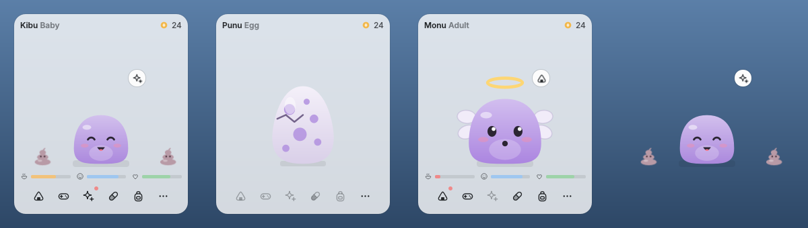
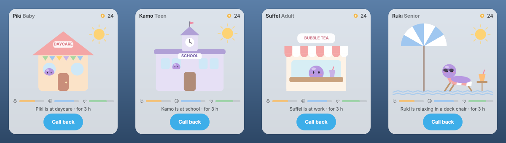
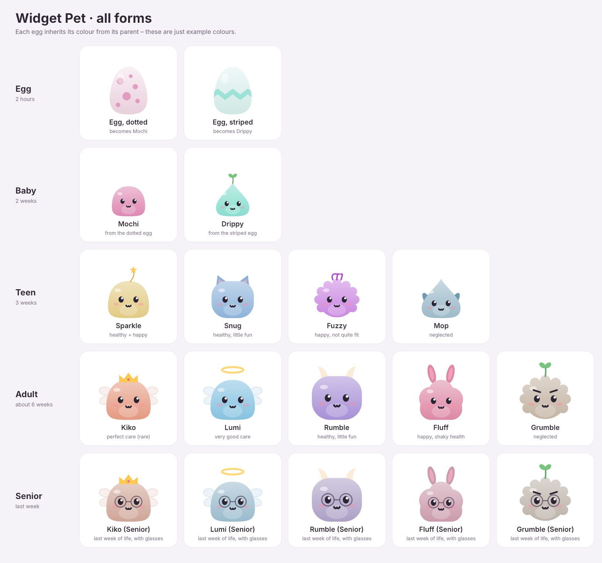
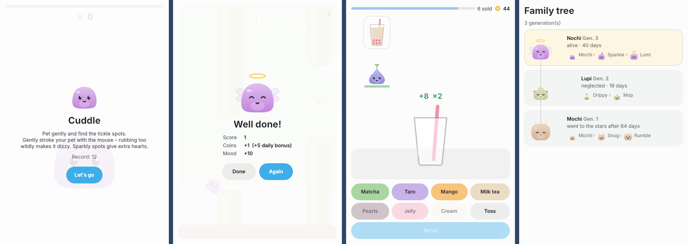

# Widget Pet

🇬🇧 English · 🇩🇪 [Deutsche Version](README.de.md)

A tiny virtual pet for the KDE Plasma 6 desktop (tested on Fedora with Plasma 6).
It hatches from an egg, grows from baby to teen to adult and, after about 12 weeks, travels to the stars –
then a new egg is waiting and your family tree grows.



## Installation

Requires KDE Plasma 6 (e.g. Fedora KDE Plasma Desktop 40 or newer).

**From the KDE Store (easiest)**
Right-click the desktop → **Add Widgets…** → **Get New Widgets** → **Download New Plasma Widgets** → search for “Widget Pet” → Install.

**From a GitHub release**
Download the `.plasmoid` file from the [releases page](https://github.com/patfrenken/widget-pet/releases), then
**Add Widgets… → Get New Widgets → Install Widget From Local File** and pick the file.

**From source**

```bash
git clone https://github.com/patfrenken/widget-pet.git
cd widget-pet
bash install.sh
```

Then right-click the desktop → **Add Widgets…** → drag “Widget Pet” onto the desktop.
After an update, Plasma only loads the new version after `systemctl --user restart plasma-plasmashell` or logging in again.

To try it without touching your desktop: `sudo dnf install plasma-sdk`, then `plasmoidviewer -a package`.

Uninstall: `bash uninstall.sh`, or **Add Widgets…** → click the widget → trash icon.

> **GNOME, XFCE & co.:** the widget needs KDE Plasma 6 and does not run on other desktops.

## How to play

The pet sits frameless on your desktop. Hover over it and a subtle frame appears with its name, coins,
three stats and the control bar. In the widget settings you can keep the frame visible all the time.

| Button | What it does |
|---|---|
| Feed | Food menu – rice balls are free, better food costs coins |
| Play | Mini games (unlocked with age), give mood and coins |
| Clean up | Removes poop |
| Medicine | Cures your pet when it's sick (hurts a little otherwise) |
| Send away (backpack) | Sends the pet to daycare, school, work or off to relax – depending on its age |
| More | Family tree, language (English/German), profile, start over |

Clicking the pet pets it (for the egg: keeps it warm, which shortens hatching). A small speech bubble shows its most urgent need.

**Language:** English by default. **More → Language: English** switches to German instantly (and back) – also available in the widget settings.

### Stats

- **Fullness** drops over time; food fills it up. Overfeeding is bad for it.
- **Mood** drops over time; playing and petting raise it. Playing a lot in a row gives a little less mood each round.
- **Health** drops with hunger, boredom, poop and sickness and recovers when everything is fine.
  With poor health, several poops or great hunger your pet quickly gets sick – and now and then it simply catches a cold.

At night (10 pm – 7 am by default) your pet sleeps; stats drop more slowly and feeding and playing wait until morning.
While your PC is off, hunger, mood and digestion keep going at about three quarters of the normal pace – your pet can get sick
and poop, but it never dies while your PC is off.
If its health stays at zero for two days while your PC is on, it dies early.

### Sending away and calling back

Before you switch off your PC for a while, send your pet off with the backpack button – depending on its age:

| Life stage | Place | Bonus |
|---|---|---|
| Baby | Daycare | – |
| Teen | School | – |
| Adult | Work at the bubble tea bar | earns 1.5 coins per hour (max. 15 per shift) |
| Senior | Relaxing in a deck chair | – |

While away its needs drop only very slowly, it doesn't poop, doesn't get sick and doesn't count towards its evolution.
Your desktop shows a picture of the place in the meantime. **Call back** brings it home.
It can't be sent away while sick.



## Life cycle & forms

| Stage | Duration | Forms (depending on health & mood in the previous stage) |
|---|---|---|
| Egg | 2 hours (up to 30 min shorter if kept warm) | dotted or striped, colour inherited from the parent |
| Baby | 2 weeks | Mochi (dotted egg), Drippy (striped egg) |
| Teen | 3 weeks | Sparkle (healthy + happy), Snug (healthy), Fuzzy (happy), Mop (neglected) |
| Adult | about 6 weeks, the last week as a senior with glasses | Kiko (perfect, rare), Lumi (very good), Rumble (healthy), Fluff (happy), Grumble (neglected) |

Good care extends its life by up to 8 days. A Lumi or Kiko parent passes on a “blessed” egg with full health; half of the coins are always inherited.



Single images (512 × 512 px, transparent background) are in `docs/pets/`.

## Mini games

| Game | From | How it works |
|---|---|---|
| Cuddle | Baby | Gently stroke your pet with the mouse for 15 seconds – the cursor turns into a paw. Rubbing too wildly makes it dizzy and gives no hearts. Sparkly tickle spots give triple hearts. |
| Hop Flight | Teen | Click or press space to flutter through cloud towers. Stars give bonus coins; it slowly speeds up. |
| Bubble Tea Bar | Adult | A 60-second shift: build each cup as ordered (tea + topping, later with cream) and serve it. Fast service and streaks earn bigger tips. |

The first game of the day gives a 5-coin daily bonus. Records are saved per game and inherited.



## Time-lapse for testing

Besides real time, the widget settings offer **60×** (one life ≈ 1.4 days) and
**1440×** (one life ≈ 1.4 hours) – handy to see every stage and form.

## Project layout

```
package/
  metadata.json            Plasma package description
  contents/config/         settings (main.xml, config.qml)
  contents/ui/
    main.qml               entry point (PlasmoidItem)
    logic.js               game logic without QML – testable with Node
    strings.js             translations (German → English)
    PetModel.qml           load/save state, clock, actions
    PetWidget.qml          widget with hover frame and controls
    PetScene.qml           stage with animations
    PetCanvas.qml          draws pets and eggs
    AwayCanvas.qml         pictures for daycare, school, work, deck chair
    MenuSheet.qml          food, games and more menu
    PetWindow.qml          window for mini games and family tree
    AncestryView.qml       family tree
    games/                 Cuddle, Hop Flight, Bubble Tea Bar
tools/simulate.js          simulates 12 weeks with different player types (node tools/simulate.js)
tools/check-translations.js  checks that every text is translated (node tools/check-translations.js)
build-plasmoid.sh          builds widget-pet-<version>.plasmoid
```

Texts in the code are written in German and translated to English in `strings.js`;
`tools/check-translations.js` reports missing translations.

Your pet's state is stored in the widget configuration (`~/.config/plasma-org.kde.plasma.desktop-appletsrc`).
If you remove the widget from your desktop, the pet is gone too.

## How it was made

Widget Pet is a hobby project and was largely built with AI assistance (“vibe coded”):
the idea, game concept, design decisions and testing are mine; the code was written with
**Claude Opus 5.5** (Anthropic), using the **Qt Development Skills** plugin (Qt Group) for QML.
Commits with AI involvement are marked with `Co-Authored-By: Claude`.

Found a bug or have an idea for a new pet or mini game? Feel free to open an [issue](https://github.com/patfrenken/widget-pet/issues).

## License

[MIT](LICENSE)
