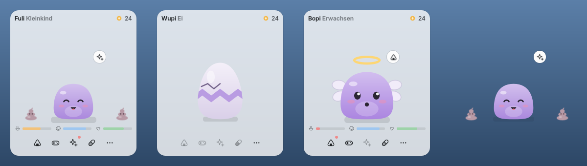
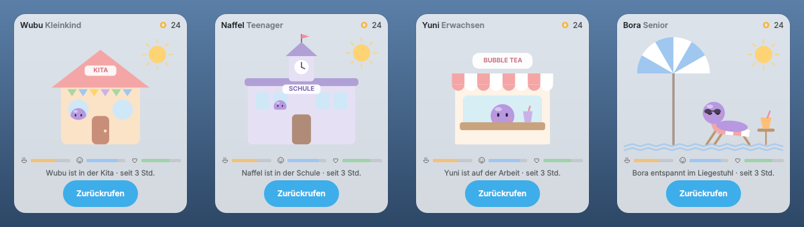
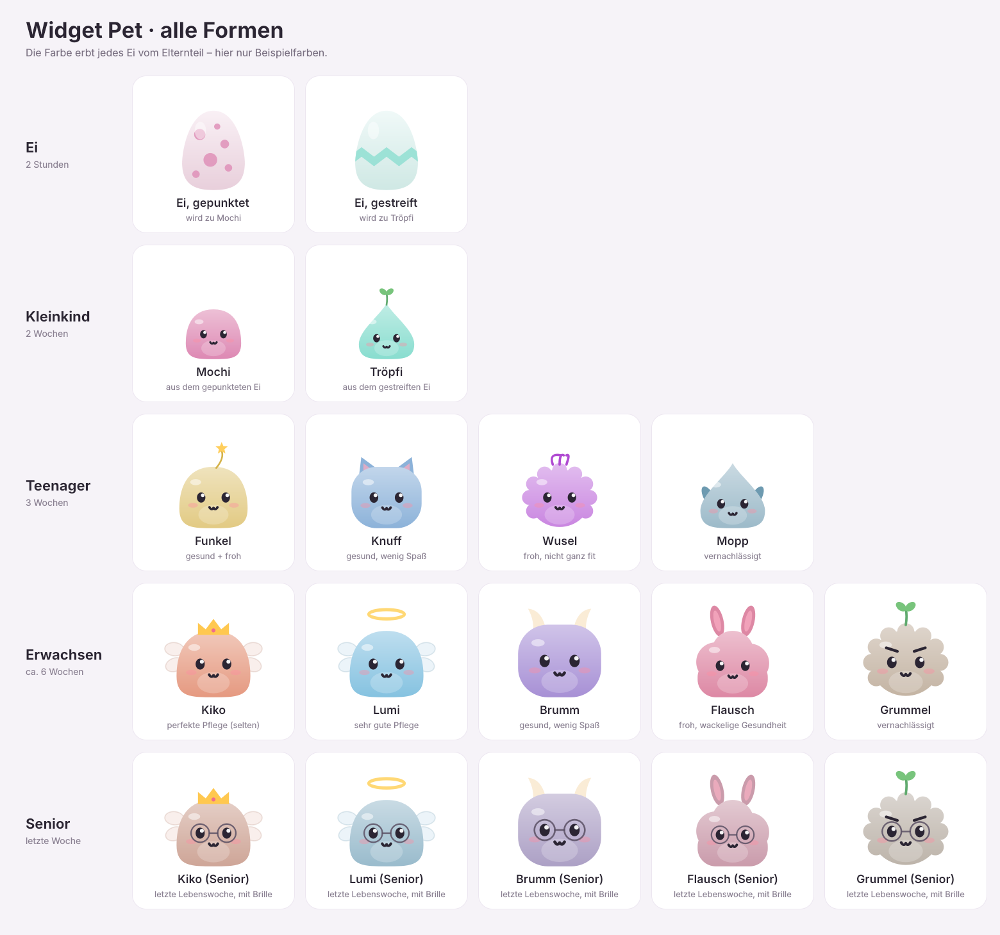
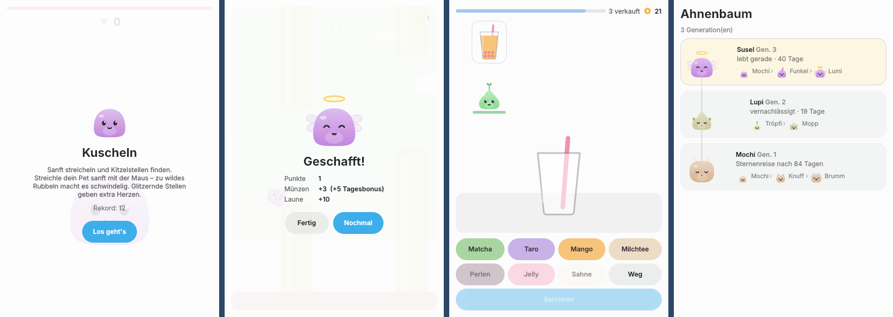

# Widget Pet

Ein kleines digitales Haustier als KDE-Plasma-6-Widget für den Desktop (getestet für Fedora mit Plasma 6).
Es schlüpft aus einem Ei, wächst über Kleinkind und Teenager zum Erwachsenen heran und reist nach
rund 12 Wochen zu den Sternen – danach liegt ein neues Ei bereit und der Ahnenbaum wächst.



## Installation

Voraussetzung: KDE Plasma 6 (z. B. Fedora KDE Plasma Desktop 40 oder neuer).

**Über den KDE Store (am einfachsten)**
Rechtsklick auf den Desktop → **Widgets hinzufügen…** → **Neue Widgets holen** → **Neue Plasma-Widgets herunterladen** → nach „Widget Pet“ suchen → Installieren.

**Aus dem GitHub-Release**
`widget-pet.plasmoid` von der [Release-Seite](https://github.com/patfrenken/widget-pet/releases) herunterladen, dann
**Widgets hinzufügen… → Neue Widgets holen → Widget aus lokaler Datei installieren** und die Datei auswählen.

**Aus dem Quellcode**

```bash
git clone https://github.com/patfrenken/widget-pet.git
cd widget-pet
bash install.sh
```

Danach: Rechtsklick auf den Desktop → **Widgets hinzufügen…** → „Widget Pet“ auf den Desktop ziehen.
Nach einem Update lädt Plasma die neue Version erst nach `systemctl --user restart plasma-plasmashell` oder einer Neuanmeldung.

Zum Ausprobieren ohne Desktop: `sudo dnf install plasma-sdk` und dann `plasmoidviewer -a package`.

Deinstallieren: `bash uninstall.sh` oder über **Widgets hinzufügen…** → Widget anklicken → Papierkorb.

> **GNOME, XFCE & Co.:** Das Widget braucht KDE Plasma 6 und läuft nicht auf anderen Desktops.

## Bedienung

Das Pet sitzt rahmenlos auf dem Desktop. Fährst du mit der Maus darüber, erscheinen ein dezenter Rahmen,
Name, Münzen, drei Werte und die Steuerleiste. In den Widget-Einstellungen kannst du den Rahmen auch dauerhaft einblenden.

| Knopf | Wirkung |
|---|---|
| Füttern | Futtermenü – Reisbällchen ist gratis, besseres Essen kostet Münzen |
| Spielen | Minispiele (je nach Alter freigeschaltet), bringen Laune und Münzen |
| Saubermachen | Häufchen wegräumen |
| Medizin | Heilt, wenn das Pet krank ist (sonst schadet sie ein bisschen) |
| Wegschicken (Rucksack) | Schickt das Pet in die Kita, zur Schule, zur Arbeit oder zum Entspannen – je nach Alter |
| Mehr | Ahnenbaum, Steckbrief, Neu beginnen |

Ein Klick auf das Pet streichelt es (beim Ei: wärmen, das verkürzt die Brutzeit). Eine kleine Sprechblase zeigt das dringendste Bedürfnis.

### Werte

- **Sättigung** sinkt mit der Zeit, Essen füllt sie auf. Überfüttern schadet.
- **Laune** sinkt mit der Zeit, Spielen und Streicheln heben sie. Spielt man sehr viel am Stück, bringt jede Runde etwas weniger Laune.
- **Gesundheit** sinkt bei Hunger, Langeweile, Häufchen und Krankheit und erholt sich, wenn alles passt.
  Bei schlechter Gesundheit, mehreren Häufchen oder großem Hunger wird das Pet schnell krank – ab und zu erwischt es auch einfach eine Erkältung.

Nachts (Standard 22–7 Uhr) schläft das Pet; die Werte sinken dann langsamer, Füttern und Spielen gehen erst wieder morgens.
Ist der PC aus, laufen Hunger, Laune und Verdauung fast normal weiter (etwa drei Viertel des Tempos), das Pet kann krank werden
und Häufchen machen – es stirbt aber nie, während der PC aus ist.
Steht die Gesundheit bei laufendem PC zwei Tage lang auf null, stirbt das Pet vorzeitig.

### Wegschicken und Zurückrufen

Bevor du den PC länger ausschaltest, schick dein Pet mit dem Rucksack-Knopf los – je nach Lebensabschnitt:

| Lebensabschnitt | Ort | Besonderheit |
|---|---|---|
| Kleinkind | Kita | – |
| Teenager | Schule | – |
| Erwachsen | Arbeit in der Bubble-Tea-Bar | verdient 1,5 Münzen pro Stunde (max. 15 pro Schicht) |
| Senior | Entspannen im Liegestuhl | – |

Unterwegs sinken die Bedürfnisse nur stark gebremst, es macht keine Häufchen, wird nicht krank und zählt nicht in die Entwicklung hinein.
Auf dem Desktop siehst du solange ein Bild vom Ort. Über **Zurückrufen** kommt es wieder nach Hause.
Krank kann es nicht losgeschickt werden.



## Lebenszyklus & Varianten

| Stadium | Dauer | Varianten (abhängig von Gesundheit & Laune im Stadium davor) |
|---|---|---|
| Ei | 2 Stunden (durch Wärmen bis zu 30 Min. kürzer) | Muster gepunktet oder gestreift, Farbe vom Elternteil geerbt |
| Kleinkind | 2 Wochen | Mochi (gepunktetes Ei), Tröpfi (gestreiftes Ei) |
| Teenager | 3 Wochen | Funkel (gesund + froh), Knuff (gesund), Wusel (froh), Mopp (vernachlässigt) |
| Erwachsen | ca. 6 Wochen, die letzte Woche als Senior mit Brille | Kiko (perfekt, selten), Lumi (sehr gut), Brumm (gesund), Flausch (froh), Grummel (vernachlässigt) |

Gute Pflege verlängert das Leben um bis zu 8 Tage. Ein Lumi- oder Kiko-Elternteil vererbt ein „gesegnetes“ Ei mit voller Gesundheit; die Hälfte der Münzen wird immer vererbt.



Einzelbilder (512 × 512 px, transparenter Hintergrund) liegen in `docs/pets/`.

## Minispiele

| Spiel | Ab | Ablauf |
|---|---|---|
| Kuscheln | Kleinkind | 15 Sekunden sanft mit der Maus über das Pet streichen – der Zeiger wird dabei zur Pfote. Zu wildes Rubbeln macht das Pet schwindelig und bringt keine Herzen. Glitzernde Kitzelstellen geben dreifach Herzen. |
| Hüpfflug | Teenager | Mit Klick oder Leertaste durch Wolkentürme flattern. Sterne geben Bonus-Münzen, es wird langsam schneller. |
| Bubble-Tea-Bar | Erwachsen | 60-Sekunden-Schicht: Becher wie bestellt bauen (Tee + Topping, später mit Sahne) und servieren. Schnelle Bedienung und Serien geben mehr Trinkgeld. |

Das erste Spiel des Tages bringt 5 Münzen Tagesbonus. Rekorde werden pro Spiel gespeichert und vererbt.



## Zeitraffer zum Testen

In den Widget-Einstellungen gibt es neben Echtzeit die Stufen **60×** (ein Leben ≈ 1,4 Tage) und
**1440×** (ein Leben ≈ 1,4 Stunden). Ideal, um alle Stadien und Varianten zu sehen.

## Aufbau

```
package/
  metadata.json            Plasma-Paketbeschreibung
  contents/config/         Einstellungen (main.xml, config.qml)
  contents/ui/
    main.qml               Einstieg (PlasmoidItem)
    logic.js               Spiellogik ohne QML – auch mit Node testbar
    PetModel.qml           Zustand laden/speichern, Takt, Aktionen
    PetWidget.qml          Widget mit Hover-Rahmen und Steuerung
    PetScene.qml           Bühne mit Animationen
    PetCanvas.qml          zeichnet Pets und Eier
    MenuSheet.qml          Futter-, Spiele- und Mehr-Menü
    PetWindow.qml          Fenster für Minispiele und Ahnenbaum
    AncestryView.qml       Ahnenbaum
    games/                 Kuscheln, Hüpfflug, Bubble-Tea-Bar
tools/simulate.js          simuliert 12 Wochen mit verschiedenen Spielertypen (node tools/simulate.js)
```

Der Spielstand liegt in der Widget-Konfiguration (`~/.config/plasma-org.kde.plasma.desktop-appletsrc`).
Wird das Widget vom Desktop entfernt, ist auch das Pet weg.

## Entstehung

Widget Pet ist ein Hobbyprojekt und wurde größtenteils KI-gestützt („vibe coded“) erstellt:
Idee, Spielkonzept, Gestaltungsentscheidungen und Tests stammen von mir, der Code wurde mit
**Claude Opus 5.5** (Anthropic) geschrieben – mit dem Plugin **Qt Development Skills** (Qt Group) für QML.
Die Commits mit KI-Beteiligung sind mit `Co-Authored-By: Claude` gekennzeichnet.

Fehler gefunden oder eine Idee für ein neues Pet oder Minispiel? Gern als [Issue](https://github.com/patfrenken/widget-pet/issues).

## Lizenz

[MIT](LICENSE)
